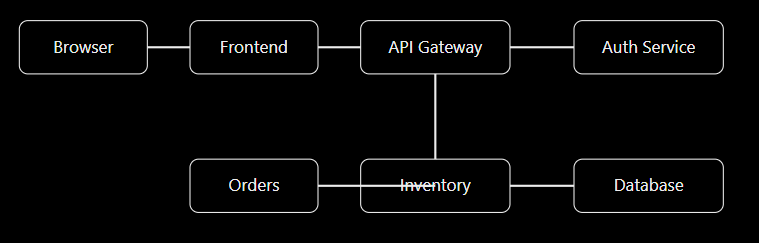
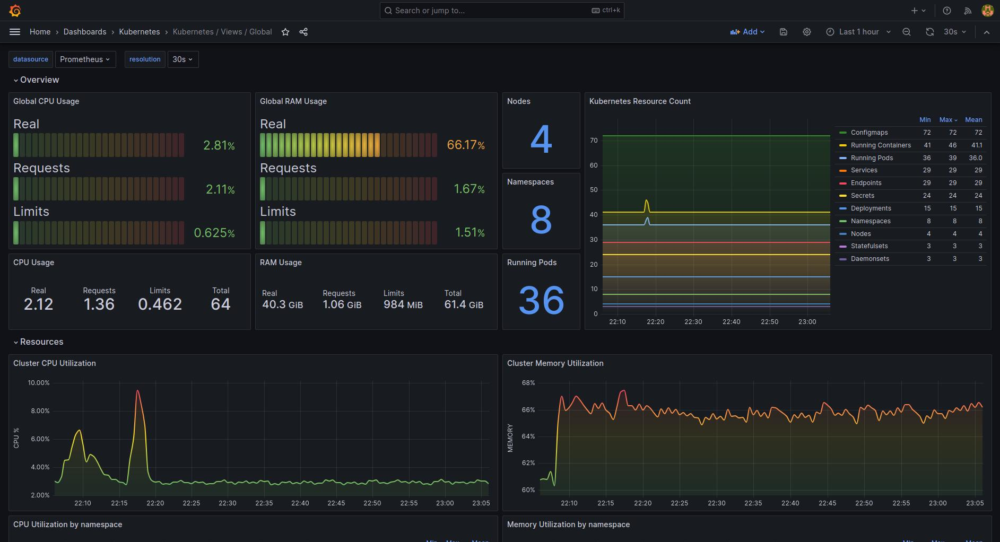
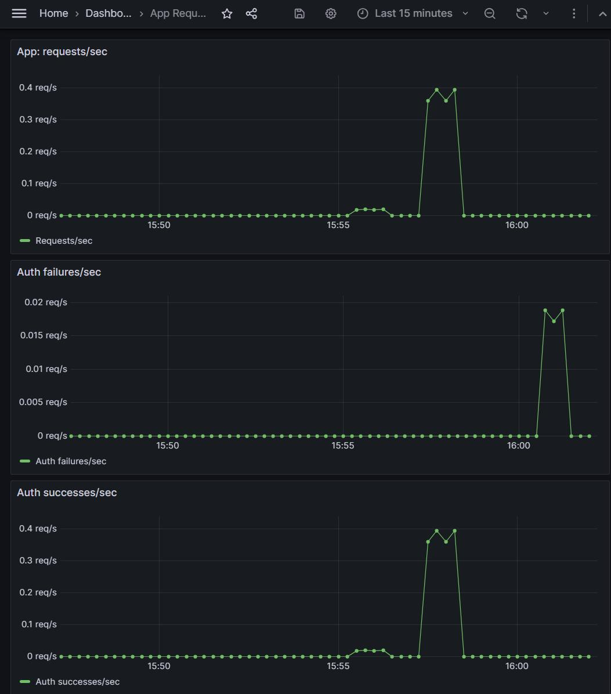
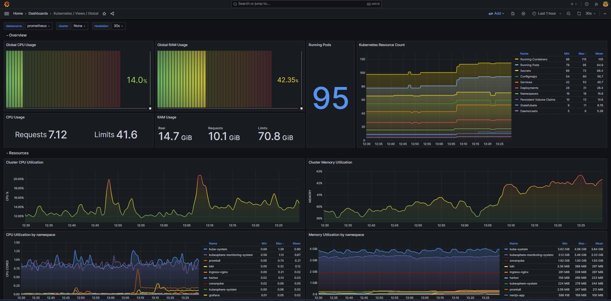
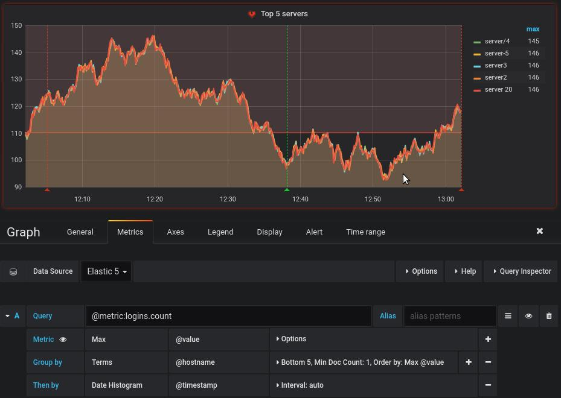
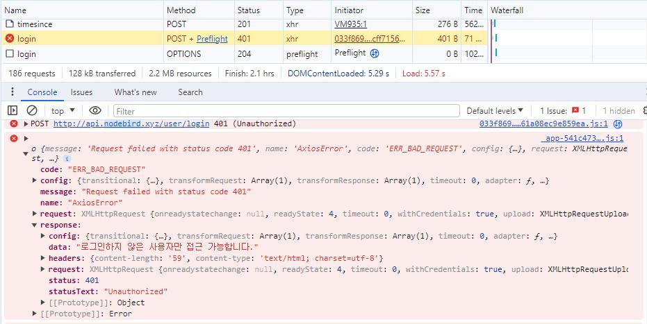
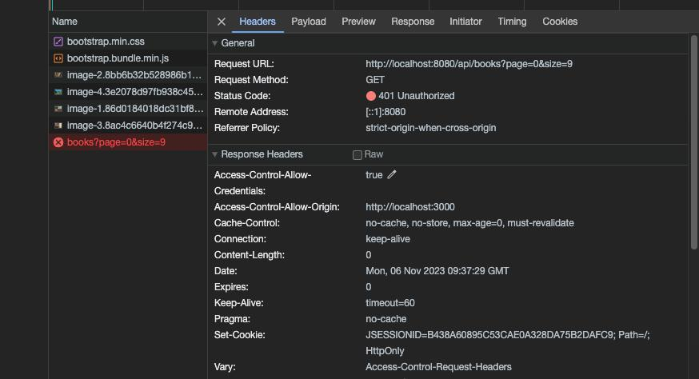
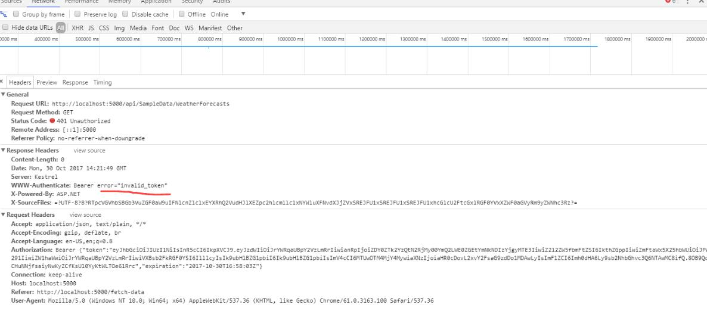
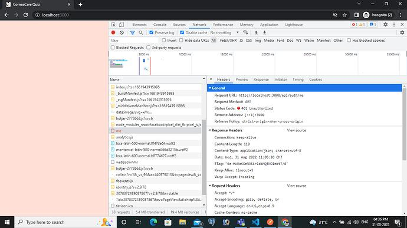
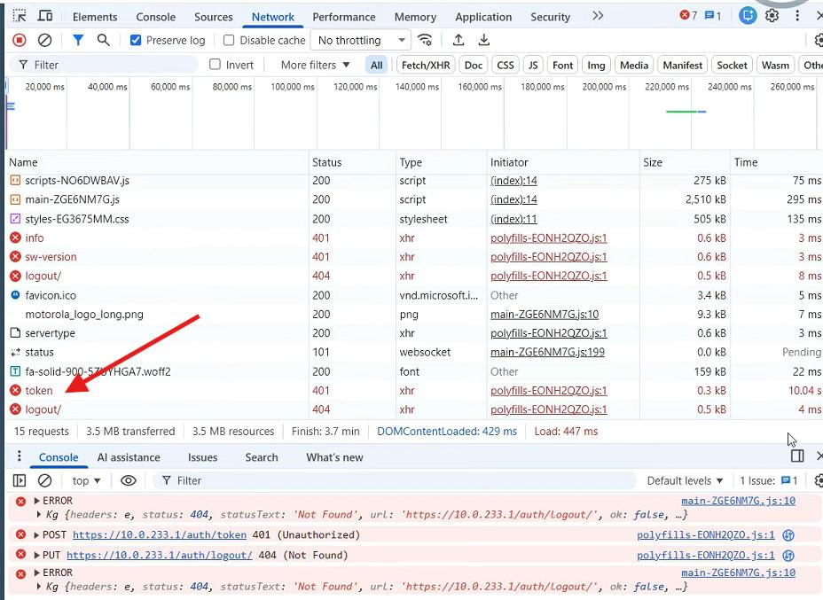

# Chapter 1 – The Door That Locked Itself
Boston, 4:31 PM.
Grant's phone slammed onto the conference table.
"It's dead."
Nobody moved.
The giant television that should have displayed Meridian's warehouse platform instead showed a single message.
```
Authentication Failed
Session expired.
```
Kevin, the youngest backend engineer on Emily's team, stared at his keyboard.
"I... I didn't touch anything."
Across the room sat Priya Nair, a graduate DevOps engineer only three months into her first software job. She had spent the afternoon documenting Kubernetes deployments and looked equally horrified.
Grant pointed at them.
"Fix it."
Priya whispered to Kevin.
"I don't even have production permissions."
Kevin answered.
"I don't think anyone does."
The room suddenly became very quiet.
---
## The Emergency Architecture Room
Instead of trying random fixes, Daniel—the CEO—made an unusual decision.
"Nobody changes anything."
He turned toward IT.
"I want to know how this system actually works."
That sentence changed everything.
Instead of becoming a blame meeting, the boardroom became an investigation.
Emily wasn't an employee anymore.
She was now an external technical witness.

Meet the Investigation Team
Daniel assembled a small technical task force.
- Emily Carter – Systems Architect
  Sees the whole system instead of individual pieces.
- Kevin Alvarez – Junior Backend Engineer
  Knows the code but not the infrastructure.
- Priya Nair – Graduate DevOps Engineer
  Learning Docker, Kubernetes, and cloud deployments.
- Marcus Reed – Site Reliability Engineer (SRE)
  Thinks in alerts, monitoring, and incident response.
- Sofia Chen – QA Automation Engineer
  Trusts evidence more than assumptions.
Each would become your guide into a different part of software architecture.

## The Whiteboard
Emily walked to the board.
"Before we investigate," she said, "you need to know what you're looking at."
She drew eight boxes.



"This," Emily said, "isn't one application."
"It's an ecosystem."

---
## Lesson 1: What is System Architecture?
Priya raised her hand.
"I thought architecture meant designing software."
Emily smiled.
"That's programming."
She tapped the diagram.
"Architecture is deciding how all these systems cooperate."
Think of it like a city.

| City | Software |
| --- | --- |
| Roads | APIs |
| Houses | Services |
| Power grid | Infrastructure |
| Traffic lights | Load balancers |
| Police | Security |
| Post office | Message queues |

A developer builds a house.
An architect designs the city.
---
## Following the Login

Marcus opened Grafana.










"First rule," he said.
"Never start with the code."
Kevin frowned.
"Why not?"
"Because users don't care where it's broken."
"They care that it's broken."
---
### Step 1: Reproduce the Failure
Sofia opened Chrome.
Instead of clicking randomly, she narrated every step.
1. Open login page.
2. Enter credentials.
3. Click Login.
4. Error appears.
She recorded everything.
"Evidence first."
---
### Step 2: Browser Developer Tools

Kevin pressed F12.
Network tab.












Instead of guessing, they watched every request.
One stood out.

```
Request
POST /api/login
Response
401 Unauthorized
```
Priya asked,
"So the frontend isn't broken?"
"Exactly."
The browser worked.
The request reached the server.
Something behind it refused access.
One box eliminated.
